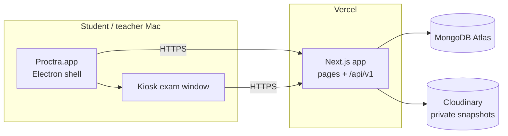

<div align="center">

# Proctra

**Timed MCQ exams on macOS, with a focused exam window and transparent, privacy-respecting proctoring.**

Teachers create and grade quizzes on the web. Students take them in a full-screen desktop app with the camera on.

[Features](#features) · [Architecture](#architecture) · [Getting started](#getting-started) · [Desktop app](#desktop-app) · [Deployment](#deployment) · [Limitations](#limitations) · [Docs](#documentation)

</div>

---

## Overview

Proctra runs exams the way a computer lab would: a fixed start and end time, a dedicated full-screen window, and the
camera on throughout. It deliberately avoids invasive "AI proctoring". There's no video recording, face analysis or
suspicion score. Instead it keeps a **still snapshot every 10 seconds** and a **neutral log of session events**
(focus changes, camera disconnects) that teachers can review.

Every rule that matters runs on the server: who may start, when time is up, what was answered, and the score.
The desktop client is never trusted with time, score or role.

## Features

### For teachers
| | |
|---|---|
| **Quiz editor** | Single-correct MCQs with 2–6 options; add, edit, reorder and remove questions; field-level validation |
| **Marking schemes** | Points for correct / wrong / unanswered answers, including negative and fractional marks |
| **Exam slots** | Fixed start and end time (1 min – 5 h); the duration is calculated. Once students start, content is locked and the end time can only be extended (every active deadline moves with it) |
| **Publishing** | Draft → published → archived; optional "show results at" release time |
| **Results** | Per-quiz submissions with marks, average, event and snapshot counts; per-student answer review |
| **Proctoring review** | Neutral event timeline with gap durations; private snapshot gallery behind signed links that expire after 10 minutes |
| **Leaderboard** | Live rankings with shared ranks for ties (1, 1, 3) |

### For students
| | |
|---|---|
| **Dashboard** | Open / upcoming / closed quizzes with a live, server-synced countdown |
| **Exam window** | Full-screen kiosk window; one question at a time, question palette, mark for review, clear answer |
| **Resilient autosave** | Every answer is saved immediately and backed up on the device while offline. Survives reloads, crashes and quitting; resume keeps the original deadline |
| **Submission** | Confirmation before submitting; automatic submit at the end time, also done by the server if the device is off |
| **Results** | Score breakdown, per-question review once released, attempt history and a live leaderboard |

### Proctoring, by design
- Camera permission is checked before an exam starts, with clear instructions for each failure (permission, no camera, camera in use).
- No live preview and no video: a JPEG still every 10 seconds, stored **privately** and visible only to the quiz's teacher.
- A blocking overlay appears if the camera disconnects mid-exam; the timer keeps running.
- Window, tab and camera events are recorded as plain facts and never labelled as misconduct.

## Architecture



- **Thin desktop shell.** The Electron app contains no secrets and no business logic. It loads the hosted web app and
  exposes exactly four capabilities through a sandboxed bridge (`window.proctra`: `isDesktop`, `requestCamera`,
  `startExam`, `endExam`), each validated in the main process.
- **Layered server.** Route handlers authenticate (`requireUser(role)`) and validate input (Zod), then call one service.
  Services own the business rules and the only database access.
- **Concurrency without infrastructure.** Single-document conditional updates make start, save and submit idempotent
  and race-safe (no double attempts, no saves after submission, no lost grading). Expired attempts are finalized lazily
  on the next read, so no queues or cron jobs are needed.

| Layer | Technology |
|---|---|
| Web app | Next.js 16 (App Router, Cache Components), React 19, TypeScript |
| UI | Tailwind CSS v4, shadcn/ui (Radix), DevClub UI, GSAP |
| API & validation | Next.js route handlers, Zod |
| Auth | Auth.js v5 (credentials, encrypted JWT cookie), bcryptjs |
| Data | MongoDB Atlas, Mongoose |
| Media | Cloudinary (authenticated assets, signed URLs) |
| Desktop | Electron 44, electron-builder |
| Hosting | Vercel |

Design documents and the full decision log live in [`docs/`](docs/README.md).

## Getting started

### Prerequisites
- macOS with **Node.js 20.9+** and npm
- A **MongoDB Atlas** cluster. Allow your IP under Network Access (and `0.0.0.0/0` if you deploy to Vercel).
- A **Cloudinary** account whose API key has a role that can **create** assets

### 1. Install
```bash
git clone https://github.com/rajdeep-2004/proctra.git
cd proctra
npm install
cp .env.example .env
```

### 2. Configure
| Variable | Required | Description |
|---|---|---|
| `MONGODB_URI` | yes | Atlas connection string, e.g. `mongodb+srv://…/proctra?retryWrites=true&w=majority` |
| `AUTH_SECRET` | yes | Session encryption secret, at least 32 characters. Generate with `openssl rand -base64 32` |
| `CLOUDINARY_CLOUD_NAME` | for snapshots | Cloudinary cloud name |
| `CLOUDINARY_API_KEY` | for snapshots | Cloudinary API key (role must allow creating assets) |
| `CLOUDINARY_API_SECRET` | for snapshots | Cloudinary API secret |
| `SEED_TEACHER_NAME` | for seeding | Display name of the teacher account |
| `SEED_TEACHER_EMAIL` | for seeding | Teacher login email |
| `SEED_TEACHER_PASSWORD` | for seeding | Teacher password (8+ characters) |
| `PROCTRA_APP_URL` | dev desktop | Site the development desktop app opens (default `http://localhost:3000`) |

If the Cloudinary keys are missing, only snapshot uploads fail; the rest of the app keeps working.

### 3. Create a teacher account
Teachers can't self-register; students can.
```bash
npm run seed   # creates or updates the teacher from SEED_TEACHER_* (safe to re-run)
```

### 4. Run
```bash
npm run dev        # web app at http://localhost:3000
npm run electron   # desktop app (second terminal). Exams can only be taken here
```

### Scripts
| Command | Description |
|---|---|
| `npm run dev` | Start the Next.js development server |
| `npm run electron` | Compile and launch the desktop shell |
| `npm run build` | Production build of the web app |
| `npm run lint` | ESLint plus TypeScript checks for the web app and Electron |
| `npm run seed` | Create or update the teacher account (`-- --promote` converts an existing student) |
| `npm run dist` | Build the macOS installers |

For automated testing without taking over the screen (ignored in packaged builds): `PROCTRA_FAKE_CAMERA=1` uses
Chromium's fake camera and `PROCTRA_KIOSK=0` opens exams in a normal window.

## Desktop app

### Build
```bash
npm run dist
```
| Output | For | Download | Installed |
|---|---|---|---|
| `release/Proctra-<version>-mac-arm64.dmg` | Apple Silicon (M1 and later) | ~120 MB | ~290 MB |
| `release/Proctra-<version>-mac-x64.dmg` | Intel Macs | ~130 MB | ~295 MB |

Packaged apps connect to the production deployment configured in `electron-builder.yml`
(`extraMetadata.proctraAppUrl`). To build against another server:
```bash
npm run dist -- -c.extraMetadata.proctraAppUrl=https://your-deployment.example.com
```

### Install
Builds are ad-hoc signed but **not notarized** by Apple, so macOS asks for confirmation once per Mac:

1. Open the `.dmg` that matches the Mac (Apple menu → About This Mac) and drag **Proctra** into **Applications**.
2. Launch Proctra. When macOS blocks it, click **Done**.
3. Allow it:
   - **macOS 15 Sequoia and later:** System Settings → **Privacy & Security** → **Open Anyway**.
   - **macOS 14 and earlier:** right-click Proctra → **Open** → **Open**.
4. If macOS reports the app **"is damaged"**, run `xattr -cr /Applications/Proctra.app` in Terminal, then open it normally.
5. Allow camera access when the first exam starts. If it was denied: System Settings → Privacy & Security → **Camera** → Proctra.

## Deployment

The web app deploys to Vercel; deploys are manual.
```bash
npx vercel deploy --prod
```
1. Set `MONGODB_URI`, `AUTH_SECRET`, `CLOUDINARY_CLOUD_NAME`, `CLOUDINARY_API_KEY` and `CLOUDINARY_API_SECRET` in the
   Vercel project for Production (and Preview).
2. Check the deployment: `GET /api/v1/health` should return `{"data":{"ok":true,"db":"up"}}`.
3. When hosting anywhere other than Vercel, also set `AUTH_TRUST_HOST=true`.

## Security and privacy

- **Least privilege on the desktop.** Context isolation, sandboxed renderers and no Node.js in pages. Navigation is
  restricted to the app's own origin, pop-ups are blocked, and only video (never the microphone) is permitted, for that origin alone.
- **Server-side authority.** Roles are enforced on every API route; students never receive correct answers before
  results are released; other students' attempts return `404`.
- **Credentials.** Passwords are hashed with bcrypt; sign-in errors don't reveal whether an account exists; secrets live
  only in environment variables, never in the desktop app.
- **Snapshots.** Stored as private Cloudinary assets and shown only through server-signed links that expire after 10 minutes.
  Choose and publish a retention period before using Proctra with real students.

## Limitations

- **Not an OS lockdown.** Kiosk mode hides the Dock and menu bar and blocks app switching, but phones, other computers,
  second displays and the power button are outside its control. **Cmd+Q deliberately works**: the attempt stays active,
  so the student can resume, or it submits automatically at the deadline.
- **Desktop-only is enforced by the client.** The pages refuse to run exams outside the app, but the API can be called
  directly. The server still enforces identity, timing and grading, and the missing camera and session data is visible to the teacher.
- **Time is not refunded** for disconnects, crashes or camera loss; the deadline is fixed.
- **Not yet implemented:** automatic snapshot retention, API rate limiting, a Content-Security-Policy header, and
  Developer ID signing / notarization.

## Project structure

```
proctra/
├── electron/            Desktop shell: main process, preload bridge, offline page, app icon
├── src/
│   ├── app/             Pages (auth, student, teacher, exam) and /api/v1 route handlers
│   ├── components/      UI: shadcn/ui primitives, exam, quiz, results, motion
│   ├── lib/             Database, auth/session, env validation, Cloudinary, API helpers
│   ├── models/          Mongoose models (users, quizzes, attempts, snapshots, events)
│   ├── schemas/         Zod request schemas
│   └── services/        Business logic: quizzes, attempts, grading, ranking, results, proctoring
├── scripts/             Teacher seed script
├── docs/                Product, architecture, system design, schema, API contracts, decision log
└── electron-builder.yml macOS packaging
```

## Documentation

| Document | Contents |
|---|---|
| [Product requirements](docs/prd.md) | Scope, users, features and non-goals |
| [Architecture](docs/architecture.md) | Components, stack, folder layout, module boundaries |
| [System design](docs/system-design.md) | Request flows, concurrency, failure handling, kiosk behaviour |
| [Database schema](docs/database-schema.md) | Collections, fields, indexes, invariants |
| [API contracts](docs/api-contracts.md) | Every endpoint, payload and error code, plus the desktop bridge |
| [Decision log](docs/decisions.md) | Each technical decision, the alternatives considered, and why |
