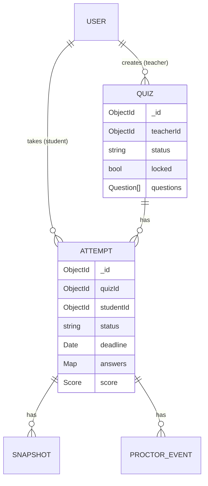

# Database Schema

> Last updated: 2026-10-19 — Update this BEFORE changing any model.

## 1. Overview
- Database: MongoDB Atlas (M0) via Mongoose, database name `proctra`
- Naming: collections plural camelCase; fields camelCase; `timestamps: true` (`createdAt`, `updatedAt`) on every model
- IDs: ObjectId everywhere (embedded questions get their own `_id`)
- Models live in `src/models/`; only `src/services/` imports them (architecture §6)

## 2. Entity relationship diagram


## 3. Entities

### User (`users`)
Purpose: an account; teachers come from the seed script, students from sign-up.

| Field | Type | Required | Default | Constraints / notes |
|---|---|---|---|---|
| _id | ObjectId | yes | auto | |
| name | string | yes | | trimmed, 1–80 chars |
| email | string | yes | | lowercased, trimmed, unique |
| passwordHash | string | yes | | bcryptjs hash; `select: false` so it's never returned by default |
| role | `"student" \| "teacher"` | yes | `"student"` | sign-up can only create `student` |
| createdAt / updatedAt | Date | yes | auto | |

**Indexes**
| Fields | Type | Why (which query) |
|---|---|---|
| `{ email: 1 }` | unique | sign-in lookup; prevents duplicate accounts |

**Example**
```json
{ "_id": "6710…a1", "name": "Asha Rao", "email": "asha@uni.edu", "role": "student" }
```

### Quiz (`quizzes`)
Purpose: a quiz with its embedded questions and marking scheme.

| Field | Type | Required | Default | Constraints / notes |
|---|---|---|---|---|
| _id | ObjectId | yes | auto | |
| teacherId | ObjectId → users | yes | | owner; only the owner can edit/view results |
| title | string | yes | | 1–200 chars |
| instructions | string | no | `""` | ≤ 5000 chars, plain text |
| startsAt | Date | yes | | availability window start |
| endsAt | Date | yes | | must be > `startsAt` |
| durationMinutes | number | yes | | integer 1–300 |
| marking.correct | number | yes | `1` | −100…100, may be fractional (e.g. 0.25) |
| marking.incorrect | number | yes | `0` | −100…100 (negative marking allowed) |
| marking.unanswered | number | yes | `0` | −100…100 |
| resultsReleaseAt | Date \| null | no | `null` | `null` = visible right after submission |
| status | `"draft" \| "published" \| "archived"` | yes | `"draft"` | see state machine §5 |
| locked | boolean | yes | `false` | set `true` when the first attempt starts; questions + marking become read-only |
| questions | Question[] | yes | `[]` | 0–200 in draft; ≥ 1 to publish. Array order = display order |
| createdAt / updatedAt | Date | yes | auto | |

**Question (embedded)**
| Field | Type | Required | Constraints |
|---|---|---|---|
| _id | ObjectId | yes | stable id used as the answer key in attempts |
| text | string | yes | 1–2000 chars |
| options | string[] | yes | 2–6 items, each 1–500 chars |
| correctIndex | number | yes | integer, `0 ≤ correctIndex < options.length`; never sent to students before release |

**Indexes**
| Fields | Type | Why (which query) |
|---|---|---|
| `{ teacherId: 1, updatedAt: -1 }` | compound | teacher dashboard: my quizzes, newest first |
| `{ status: 1, startsAt: 1 }` | compound | student dashboard: published quizzes ordered by start |

**Relations:** `teacherId` references `users`. Questions are embedded (always read with the quiz).
Quizzes are never hard-deleted once they have attempts — they are archived.

**Example**
```json
{
  "_id": "6710…q1", "teacherId": "6710…t1", "title": "DBMS Quiz 1",
  "instructions": "Answer all questions.", "startsAt": "2026-10-22T10:00:00Z",
  "endsAt": "2026-10-22T12:00:00Z", "durationMinutes": 30,
  "marking": { "correct": 4, "incorrect": -1, "unanswered": 0 },
  "resultsReleaseAt": null, "status": "published", "locked": true,
  "questions": [
    { "_id": "6710…k1", "text": "Which normal form removes transitive dependencies?",
      "options": ["1NF", "2NF", "3NF", "BCNF"], "correctIndex": 2 }
  ]
}
```

### Attempt (`attempts`)
Purpose: one student's single attempt at one quiz, including answers and final score.

| Field | Type | Required | Default | Constraints / notes |
|---|---|---|---|---|
| _id | ObjectId | yes | auto | |
| quizId | ObjectId → quizzes | yes | | |
| studentId | ObjectId → users | yes | | |
| studentName | string | yes | | copied from user at start (for leaderboard/submissions without a join) |
| status | `"active" \| "submitted" \| "auto_submitted"` | yes | `"active"` | only `active → submitted/auto_submitted`, never back |
| startedAt | Date | yes | now | server time |
| deadline | Date | yes | | `min(startedAt + durationMinutes, quiz.endsAt)`; set once |
| submittedAt | Date \| null | no | `null` | server time; for auto-submit = `deadline` |
| answers | Map<questionId, Answer> | yes | `{}` | key = question `_id` as hex string; missing key = unanswered |
| score | Score \| null | no | `null` | set at finalization |
| createdAt / updatedAt | Date | yes | auto | |

**Answer (embedded map value)**
| Field | Type | Notes |
|---|---|---|
| selectedIndex | number \| null | `null` = cleared / not answered |
| markedForReview | boolean | default `false` |
| savedAt | Date | server time of last save |

**Score (embedded)**
| Field | Type | Notes |
|---|---|---|
| total | number | Σ of marks below; may be negative |
| correct / incorrect / unanswered | number | counts |
| maxPossible | number | `questions.length × marking.correct` |

**Indexes**
| Fields | Type | Why (which query) |
|---|---|---|
| `{ quizId: 1, studentId: 1 }` | unique | one attempt per student per quiz; start/resume lookup; blocks double-start races |
| `{ studentId: 1, startedAt: -1 }` | compound | student profile history, "active attempt to resume" |
| `{ quizId: 1, status: 1, "score.total": -1 }` | compound | teacher submissions list + leaderboard sort |

**Relations:** references `quizzes` and `users`. Snapshots and events reference the attempt.

**Example**
```json
{
  "_id": "6710…a9", "quizId": "6710…q1", "studentId": "6710…s1", "studentName": "Asha Rao",
  "status": "submitted", "startedAt": "2026-10-22T10:05:00Z", "deadline": "2026-10-22T10:35:00Z",
  "submittedAt": "2026-10-22T10:31:12Z",
  "answers": { "6710…k1": { "selectedIndex": 2, "markedForReview": false, "savedAt": "2026-10-22T10:07:41Z" } },
  "score": { "total": 4, "correct": 1, "incorrect": 0, "unanswered": 0, "maxPossible": 4 }
}
```

### Snapshot (`snapshots`)
Purpose: metadata for one camera still stored in Cloudinary.

| Field | Type | Required | Default | Constraints / notes |
|---|---|---|---|---|
| _id | ObjectId | yes | auto | |
| attemptId | ObjectId → attempts | yes | | |
| quizId | ObjectId → quizzes | yes | | copied for per-quiz cleanup |
| publicId | string | yes | | Cloudinary id, `type: authenticated`; folder `proctra/<quizId>/<attemptId>` |
| capturedAt | Date | yes | | client capture time (informational only) |
| createdAt | Date | yes | auto | server receive time |

**Indexes**
| Fields | Type | Why |
|---|---|---|
| `{ attemptId: 1, capturedAt: 1 }` | compound | gallery in time order; snapshot count per attempt |

### ProctorEvent (`proctorEvents`)
Purpose: neutral log of window/camera/upload events during an attempt.

| Field | Type | Required | Default | Constraints / notes |
|---|---|---|---|---|
| _id | ObjectId | yes | auto | |
| attemptId | ObjectId → attempts | yes | | |
| quizId | ObjectId → quizzes | yes | | |
| type | enum | yes | | `window_blur`, `window_focus`, `tab_hidden`, `tab_visible`, `fullscreen_exit`, `camera_lost`, `camera_restored`, `snapshot_failed`, `resumed` |
| occurredAt | Date | yes | | client time, clamped server-side to `[startedAt, deadline + grace]` |
| createdAt | Date | yes | auto | server receive time |

**Indexes**
| Fields | Type | Why |
|---|---|---|
| `{ attemptId: 1, occurredAt: 1 }` | compound | teacher submission view; event counts |

## 4. Access patterns
| Query | Used by | Index used | Frequency |
|---|---|---|---|
| User by email | sign-in, register | `users.email` | per sign-in |
| Teacher's quizzes | teacher dashboard | `quizzes.teacherId_updatedAt` | per page view |
| Published quizzes (+ my attempt per quiz) | student dashboard | `quizzes.status_startsAt` + `attempts.studentId_startedAt` | per page view |
| Attempt by `{quizId, studentId}` | start/resume | `attempts.quizId_studentId` (unique) | per start |
| Attempt by `_id` + `studentId` | exam load, save answer, submit, snapshot | `_id` | ~every few seconds per student during an exam |
| Student's attempts newest first | profile | `attempts.studentId_startedAt` | per page view |
| Finalized attempts of a quiz by score | submissions, leaderboard | `attempts.quizId_status_score.total` | per page view |
| Events / snapshots of an attempt | teacher submission view | `*.attemptId_*` | per page view |

## 5. Validation and invariants
| Invariant | Enforced where |
|---|---|
| Email unique | unique index + `409 CONFLICT` in register service |
| Only students can self-register | register service hardcodes `role: "student"` |
| `endsAt > startsAt`, duration 1–300, 2–6 options, valid `correctIndex` | Zod schema (`src/schemas/quiz.ts`) + Mongoose validators |
| Publish needs ≥ 1 question | quiz service `publish()` |
| Quiz state machine: `draft ⇄ published → archived` (archived is final; unpublish returns to draft) | quiz service, conditional updates |
| Questions/marking read-only once `locked` | quiz service update uses `{ locked: false }` condition for those fields; title/instructions/endsAt/resultsReleaseAt stay editable |
| One attempt per student per quiz | unique index |
| Attempt status only moves forward | `findOneAndUpdate({ status: "active" })` |
| Answers only change while `active` and before `deadline + 5 s` | conditional `updateOne` in attempt service |
| Answer key must be a question of the quiz; `selectedIndex` within that question's options | attempt service (validates against the quiz before writing) |
| `score` is only written by the grading service | attempt service, never from request input |

## 6. Migrations and seed data
| Date | Change | Migration / script | Backfill needed |
|---|---|---|---|
| 2026-10-19 | Initial models | none (Mongoose creates collections; `syncIndexes()` in dev) | no |
| 2026-10-19 | Teacher accounts | `npm run seed` → `scripts/seed-teachers.ts` (reads `SEED_TEACHER_*` env; idempotent upsert by email; refuses to convert an existing student unless `--promote`) | no |
