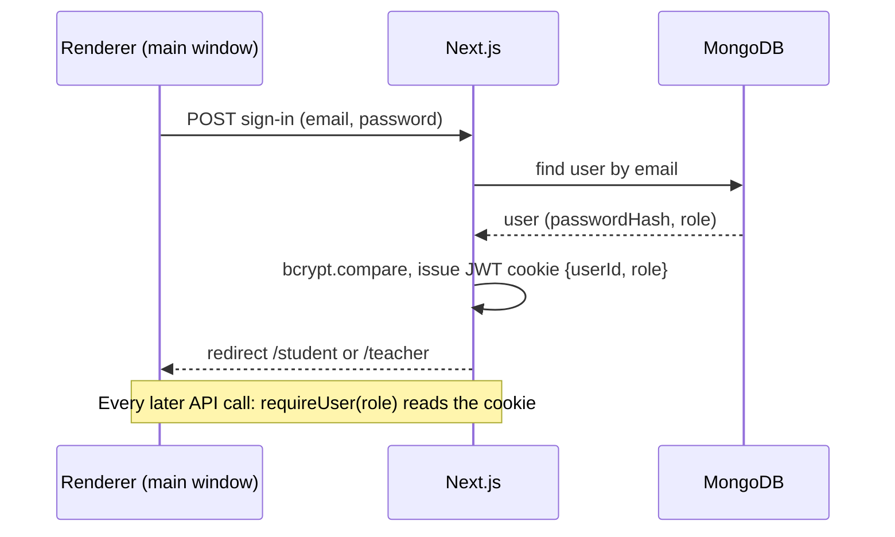
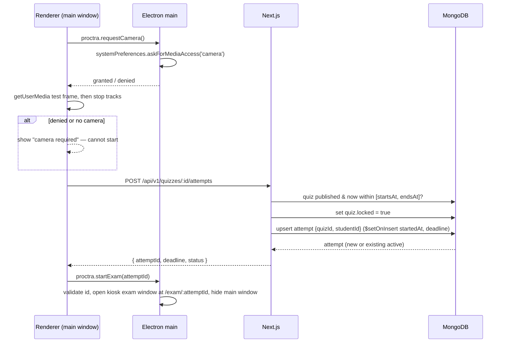
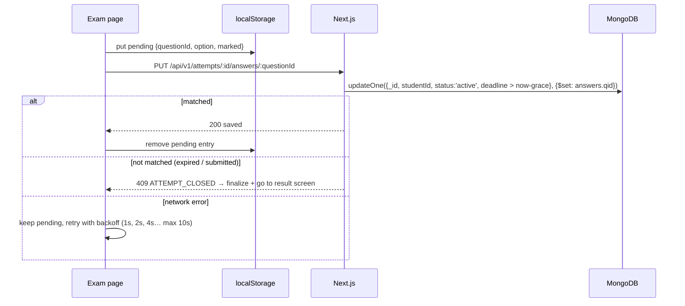
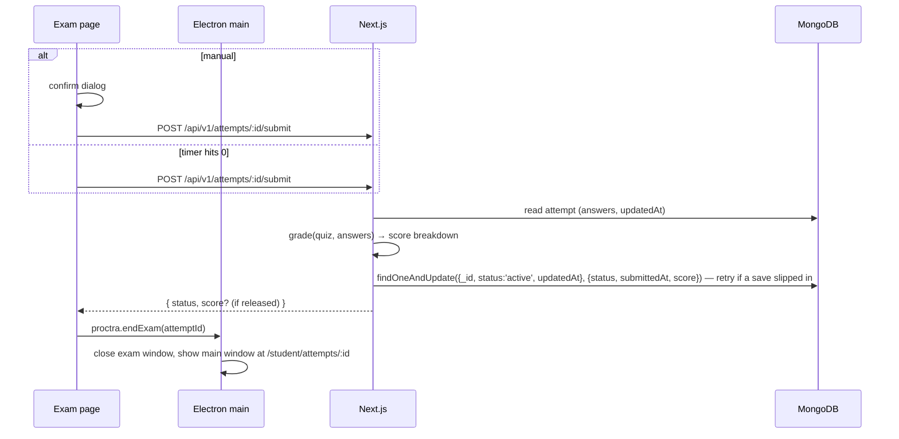
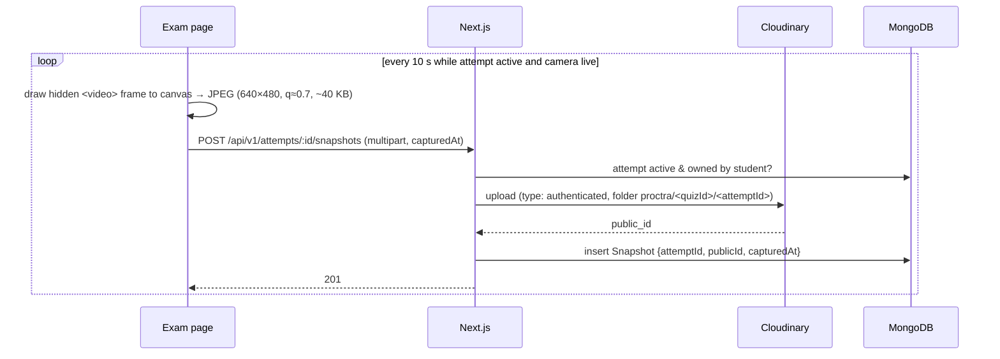

# System Design

> Last updated: 2026-10-19 — How the system behaves at runtime. Structure lives in architecture.md.

## 1. Requirements that drive the design
| Requirement | Target | Why it matters |
|---|---|---|
| Concurrent users | ≤ 100 students in one exam | Sizes everything: free tiers are enough, no cache/queue needed |
| Write load | ~1 answer save / student / 10 s + 1 snapshot / student / 10 s → ≤ ~20 req/s peak | Comfortably inside Vercel + Atlas M0 limits |
| Latency | Answer save confirmed < 1 s on normal network | Student sees "Saved" quickly |
| Consistency | Server is the single source of truth for role, deadline, answers, score | Prevents client tampering (renderer is untrusted) |
| Durability | Every answer shown as "Saved" survives app crash / power loss | Resume after interruption |
| Availability | Best effort (free tiers); exam UI tolerates short network drops | Local pending-save queue + retries |

## 2. Key flows

### Flow: Sign-in and role routing

### Flow: Start (or resume) an attempt

Notes:
- `deadline = quiz.endsAt` (fixed exam slot, D-041). Stored on the attempt so every write can check it atomically;
  if the teacher extends the quiz, `updateMany({ quizId, status: "active" }, { deadline: newEndsAt })` moves all active attempts.
- Calling start again while an attempt is `active` just returns it → this **is** the resume path.
- If the attempt is already submitted, start returns `409 CONFLICT` (one attempt per quiz).

### Flow: Answer autosave

Notes:
- The client save queue sends **one request at a time** and coalesces: if a question changes again
  while a save is in flight, only the newest value is sent next. This prevents an older save from
  arriving after a newer one and overwriting it.
- Status indicator: `Saved` (queue empty) / `Saving…` / `Offline — retrying`.
- On exam page load, pending entries from localStorage for this attempt are replayed before showing "Saved".
- Grace window: saves are accepted until `deadline + 5 s` to absorb network latency for clicks made just before time ran out.

### Flow: Submit, auto-submit and lazy finalization

- **No background jobs.** If nobody calls submit (app closed, battery dead), the attempt is finalized
  **lazily**: every service function that reads an attempt (`getAttempt`, student dashboard, teacher
  submissions, leaderboard) first runs `finalizeIfExpired()`, which atomically flips any `active`
  attempt with `now > deadline + grace` to `auto_submitted` with `submittedAt = deadline` and grades it.
- Manual submit after the deadline is treated as auto-submit (`submittedAt = deadline`).

### Flow: Snapshot capture

- Upload failure: retry twice (2 s, 5 s) then drop that frame and log a `snapshot_failed` event. Never blocks the exam.
- No live preview: the `<video>` element is never rendered visibly.
- Capture stops (tracks stopped) on submit, auto-submit, or exam window close.

### Flow: Camera lost mid-attempt
1. Video track fires `ended` (or `devicechange` shows no camera) → exam page shows a full-screen
   "Camera disconnected — reconnect to continue" overlay; answer inputs are disabled.
2. Event `camera_lost` is logged. Countdown keeps running (server deadline unchanged).
3. Every 2 s the page retries `getUserMedia`; on success the overlay closes and `camera_restored` is logged.
4. If the deadline passes while the overlay is up, the normal auto-submit runs with the answers saved so far.

### Flow: Window / focus events
- Exam page listens to DOM `blur`/`focus`, `visibilitychange` and `fullscreenchange`, and batches
  them to `POST /api/v1/attempts/:id/events` every 5 s (or immediately on submit).
- Events shown to teachers with neutral wording ("window lost focus at 10:14:03 for 12 s").

### Flow: Leaderboard (live, D-049)
1. Access: owner teacher always; a student only after finishing their own attempt **and** once results are released.
2. `finalizeExpiredForQuiz` → load finished attempts `{studentName, score}` + count of still-active ones.
3. Ranking (`ranking.ts`, D-059): marks high → low, then `submittedAt` early → late (auto-submits carry the deadline). A rank is
   shared only when marks and submit time are both equal (→ 1, 1, 3), listed by name. Each entry returns `submittedAt` ("Finished").
4. Response: name, rank, score only, plus `live` (exam not over or someone still writing) and `stillWriting`.
5. While `live`, the page re-fetches every 10 s; when everyone is final it stops. No push channel (D-014).

### Flow: Teacher's student page (v1/05, D-064)
1. `GET /api/v1/teacher/students/:id` (or the page calling the service directly): load this teacher's quiz ids.
2. `Attempt.exists({ studentId, quizId: { $in: myQuizIds } })`. If nothing matches → **404**, the same answer as an unknown
   id, so the endpoint can't be used to check whether a student exists.
3. Lazy finalization for the student, then the user's name/email and the scoped attempts (newest first, ≤ 200) in parallel.
4. Owner rule: marks show even before the release time (as on the submissions table); answers and correct options are never
   included. Tiles and trend come from the shared `historyStats` helper.

### Flow: Analytics (v1/04, D-061–D-063)
1. No extra queries: the teacher results page reuses `listSubmissions` rows; the profile reuses `listMyAttempts` rows.
2. Numbers are computed per request on the server with pure helpers (`score-stats.ts`): summary (count, mean, median, min,
   max), score % (marks ÷ max), pooled accuracy, 10% histogram buckets (+ "Below 0%" only when needed).
3. Teacher: marks stats and the distribution use finished attempts only. Student: "Tests taken" counts finished attempts;
   every marks-based number uses released results only. `score` is already `null` before release, so the guard lives in the service.
4. Charts are client components (recharts). The trend chart draws only after hydration because its dates are the viewer's
   local dates. Each chart also renders a visually hidden table for screen readers; animation is off.

## 3. State and data ownership
| Data | Source of truth | Copies |
|---|---|---|
| Users, roles | MongoDB `users` | Role copied into the JWT (refreshed on sign-in) |
| Quizzes + correct answers | MongoDB `quizzes` | Never sent to students before release |
| Answers | MongoDB `attempts.answers` | Pending (unconfirmed) answers in localStorage until server confirms |
| Deadline, status, score | MongoDB `attempts` | Client shows countdown from `deadline` + server-time offset |
| Snapshot images | Cloudinary (private) | Only `publicId` + metadata in MongoDB |
| Proctor events | MongoDB `proctorEvents` | Client buffer for ≤ 5 s |
| Session | JWT cookie | Electron persistent session partition |

**Clock skew:** `GET /attempts/:id` returns `serverNow`; client computes `offset = serverNow − Date.now()`
and shows `deadline − (Date.now() + offset)`. The client countdown is cosmetic; the server decides.

## 4. Concurrency and race conditions
| Scenario | Risk | Mitigation |
|---|---|---|
| Student double-clicks Start / two windows | Two attempts for one quiz | Unique index `{quizId, studentId}` + upsert with `$setOnInsert`; duplicate-key error → re-read existing |
| Save arrives after submit/deadline | Answers change after grading | Conditional `updateOne` requires `status:'active'` and `deadline > now − grace` |
| Two saves for the same question out of order | Older value overwrites newer | Client queue: one in-flight request, coalesce to newest value |
| Manual submit + auto-submit + lazy finalize at once | Double grading / status flip-flop | `findOneAndUpdate({status:'active'})` — only one caller wins; others read the final result (idempotent) |
| Teacher edits questions while a student starts | Student sees questions that then change | Starting sets `quiz.locked = true` **before** creating the attempt; question edits update with condition `locked:false` |
| Leaderboard viewed while others are still writing | Provisional ranks | Only finished attempts ranked; refreshes every 10 s; no "live" label (removed on user request, 2026-10-23) (D-049) |
| Teacher extends end time during active attempts | Some attempts keep the old deadline | Quiz update and `updateMany` on active attempts' `deadline`; end time can only move later, so no attempt is ever cut short (D-041) |
| Teacher unpublishes during active attempts | Students mid-exam lose quiz | Unpublish only hides it from listings/new starts; active attempts continue to deadline |

## 5. Async work and realtime
- No queues, schedulers, cron or WebSockets. Expiry is handled by lazy finalization (§2).
- Background-like client loops (all stop when the attempt ends): save queue, snapshot timer (10 s),
  event batch flush (5 s), camera retry (2 s, only when lost), countdown (1 s).

## 6. Caching
| What | Where | TTL | Invalidation |
|---|---|---|---|
| Mongoose connection | Module-level global in `lib/db.ts` | Process lifetime | n/a (reused across serverless invocations) |
| Pages / GET handlers with user data | Not cached — with Cache Components (D-026) nothing is cached unless marked `'use cache'`; we never use it for user data. GET handlers call `connection()` so they always run at request time | — | — |
No data cache: load is tiny and stale exam data would be dangerous.

## 7. Failure modes
| Failure | Detection | Behavior / recovery |
|---|---|---|
| DB unavailable | Mongoose error in service | `500 INTERNAL`; exam page keeps answers pending locally and retries |
| Vercel unreachable from Electron | `did-fail-load` in main | Main window shows offline screen with Retry; exam page shows "Offline — retrying" |
| Cloudinary timeout/error | Upload throws | 2 retries → `snapshot_failed` event, exam continues |
| Duplicate request (start/submit/save) | — | All three are idempotent (see §4) |
| App closed / battery dies mid-attempt | Attempt still `active` on next login | Dashboard shows **Resume**; re-runs camera gate and reopens kiosk window; time lost is not refunded. If deadline already passed → lazily auto-submitted |
| Camera permission denied | `askForMediaAccess` false / getUserMedia throws | Start blocked with instructions to enable in System Settings → Privacy & Security → Camera |
| Camera lost mid-attempt | Track `ended` | Blocking overlay, event logged, timer continues (§2) |
| App force-quit/crash right after sign-out | Cookie change not yet on disk | Electron flushes the cookie store on every change, so sign-out sticks (D-035) |
| Session cookie expired mid-exam | 401 from API | Session lifetime set to 12 h so it cannot expire during an exam; if it does, redirect to sign-in and resume |

## 8. Security
- **Renderer is untrusted.** Server computes deadline, status, submittedAt and score; client-sent
  values for these are ignored.
- **Authorization** on every route via `requireUser(role)` + ownership checks in services (§architecture 8).
- **Correct answers** are stripped from every student-facing quiz/attempt response until results are released.
- **Input validation:** Zod on every body/param; ObjectId format checked; snapshot uploads limited to `image/jpeg`, ≤ 500 KB.
- **Electron:** `contextIsolation: true`, `nodeIntegration: false`, `sandbox: true`; navigation and
  `window.open` restricted to the `PROCTRA_APP_URL` origin; camera permission granted only for that origin;
  IPC handlers validate arguments (attemptId must be a 24-hex string).
- **Snapshots:** Cloudinary `type: authenticated` (no public URLs); teachers get signed URLs that expire in 10 min (S-01).
- **Secrets** only in Vercel env / local `.env`; never in the Electron bundle.
- **Passwords:** bcryptjs hash; sign-in errors don't reveal whether the email exists.
- **Rate limiting:** not implemented in V1 (known debt; low risk for a class-sized deployment).

## 9. Scaling plan
What breaks first beyond a single class:
1. Cloudinary free quota (100 students × 360 snapshots/hour × ~40 KB ≈ 1.4 GB/hour of exams) → longer interval or paid plan.
2. Atlas M0 connection/ops limits → M10 tier.
3. Lazy finalization on leaderboard reads → a scheduled finalizer (Vercel cron) if quizzes get large.

## 10. Observability
- Vercel function logs (`console.error` for unexpected errors, no PII/passwords).
- Proctor event log per attempt doubles as a client-health record (snapshot failures, focus loss).
- `GET /api/v1/health` → `{ ok, db: "up" | "down" }` for manual/deploy checks. Electron's offline screen is driven by the window's `did-fail-load` event instead (D-030).

## 11. Trade-offs accepted
| Trade-off | Why acceptable now | Revisit when |
|---|---|---|
| Kiosk mode is not a lockdown (see list below) | Explicit non-goal; documented to users | Institution requires lockdown browser |
| Exam page can be opened in a normal browser by a determined user (desktop check is client-side) | Server still enforces deadline/grading; snapshot gaps are visible to teacher | Need verified desktop clients |
| Lazy finalization instead of a scheduler | No extra infra; correctness preserved | Many quizzes / analytics need timely state |
| Time lost to disconnection/camera loss is not refunded | Prevents "quit to pause the clock" abuse | Course wants accommodations |
| No rate limiting | Small trusted user base, one week deadline | Public deployment |

### Kiosk mode — what it does and does not do (macOS)
Does: full-screen exam window with no window controls, app switching (Cmd+Tab) disabled by macOS kiosk presentation, can't be closed or minimised by the student, kept above other
windows, main window hidden during the exam, only the app's own pages can load, camera only (no microphone), focus loss /
tab hiding / camera loss are logged neutrally.
macOS kiosk presentation also hides the Dock and menu bar and disables the app menu and the Force Quit dialog (⌥⌘⎋).
Cmd+Q is deliberately kept working through a shortcut that exists only while the exam window is open (D-048).
Does **not**: stop Cmd+Q (kept on purpose), the power button, a second display, a phone or another computer, or a student
opening the exam URL in a normal browser (blocked by the page, not by the server — D-013).
Quitting leaves the attempt active: the student can resume with the remaining time, or it is auto-submitted at the deadline.
